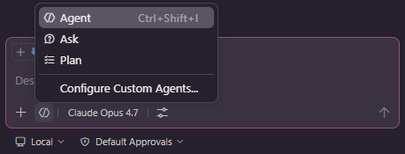

## Step 2: The initial application setup: Directory structure, Python requirements, and MongoDB

In this step, we will accomplish the following:

- Create the octofit-tracker application directory structure.
- Create the octofit-tracker/backend and octofit-tracker/frontend directories.
- Create the octofit-tracker/backend/requirements.txt file.
- Create a custom instructions file (.github/copilot-instructions.md) from the files in the `docs` folder.

1. Open all files in the `docs` folder and keep this file open in the editor throughout this exercise.
    1.  agent mode uses `mona-high-school-fitness-tracker.md` and `octofit_story.md` as a reference to create the application
2. Follow the activities below. When an activity includes a prompt, copy and paste it in GitHub Copilot Chat and select "Agent" instead of "Ask" or "Plan" from the drop down where you are inserting the prompt.



> 🪧 **Note:** 
- Do not change the model from GPT-4o this will be an optional activity at the end of the course.
- Keep in mind that the Copilot agent mode is conversational so it may ask you questions and you can ask it questions too.
- Wait a moment for the Copilot to respond and press the continue button to execute commands presented by Copilot agent mode.
- Keep files created and updated by Copilot agent mode until it is finished.
- Agent mode has the ability to evaluate your code base and execute commands and add/refactor/delete parts of your code base and automatically self heal if it or you makes a mistake in the process.

### Activity: Create the custom instructions file

Create a custom instructions file for this workspace before asking Copilot agent mode to create the application structure.

1. In GitHub Copilot Chat, click the **+** icon.
2. Select **Instructions** at the top of the menu.
3. Click on "Configure Instructions" and name the file "copilot-instructions.md`.inside the /copilot folder
4. Open each file in the `docs` folder:
    - `docs/mona-high-school-fitness-tracker.md`
    - `docs/octofit_story.md`
5. Copy the contents of both docs files into `.github/copilot-instructions.md` so Copilot has the project story, requirements, and expected application structure available throughout the rest of the exercise.
6. Save `.github/copilot-instructions.md`.

Don't proceed with the next activity until all of these steps are completed.


> ❕ **Important:** Once the above activity installs all the required packages, proceed to the next activity.

### Activity: Let's install MongoDB

> 
>
> ```prompt
> Based on the custom instructions file (.github/copilot-instructions.md) created in the previous activity, and use octofit as the name for mergington's high schools app. > Let's install MongoDB.
>
> 1. Install MongoDB and make sure the command is complete.
> 2. install mongosh to invoke shell commands.  afterwards make sure it works.
>
> Don't proceed with the next activity until all of these steps are completed.
>```

> ❕ **Important:**
- If the command completes in the terminal but agent mode shows it is still running click stop.
- You may need to paste the prompt again in agent mode.

### Activity: Let's start and verify MongoDB is running

> 
>
> ```prompt
> Based on the custom instructions file (.github/copilot-instructions.md) created in Step 2, and use octofit as the name for mergington's high schools app. > Let's start and verify MongoDB is running.
>
> 1. Start the MongoDB service.
> 2. Verify the MongoDB service running.
>
> Don't proceed with the next activity until all of these steps are completed.
>```

> ❕ **Important:**
- If the command completes in the terminal but agent mode shows it is still running click stop.
- You may need to paste the prompt again in agent mode.

1. Now that we have created the app directory structure, setup a Python virtual environment, and Copilot agent mode helped write a requirements.txt to install all project dependencies let's check our changes in to our `build-octofit-app` branch.

1. With our new changes complete, please **commit** and **push** the changes to GitHub.

1. Wait a moment for Mona to check your work, provide feedback, and share the next lesson so we can keep working!

<details>
<summary>Having trouble? 🤷</summary><br/>

If you don't get feedback, here are some things to check:

- Make sure your commit changes were made for the following file to the branch `build-octofit-app` and pushed/synchronized to GitHub:
  - `octofit-tracker/backend/requirements.txt` and it contains the package `Django==4.1`
- If Mona found a mistake, simply make a correction and push your changes again. Mona will check your work as many times as needed.

</details>
